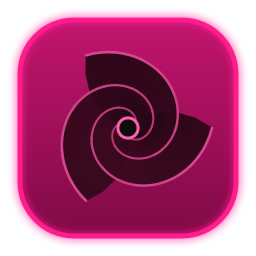
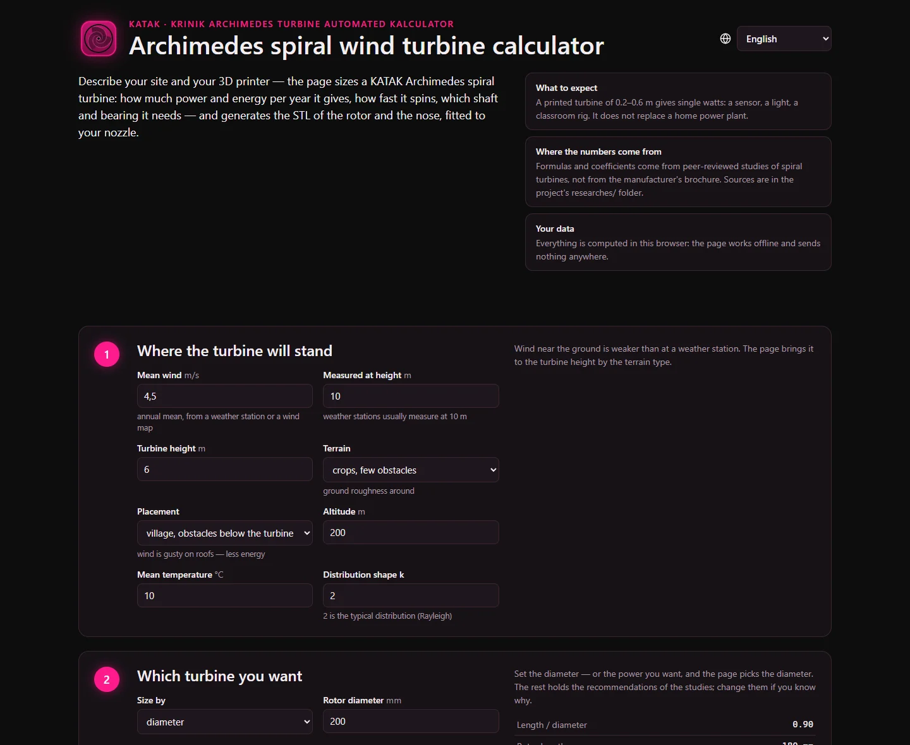
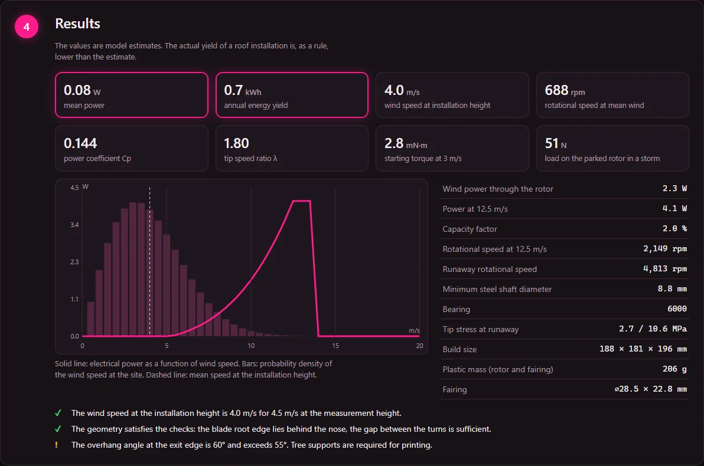
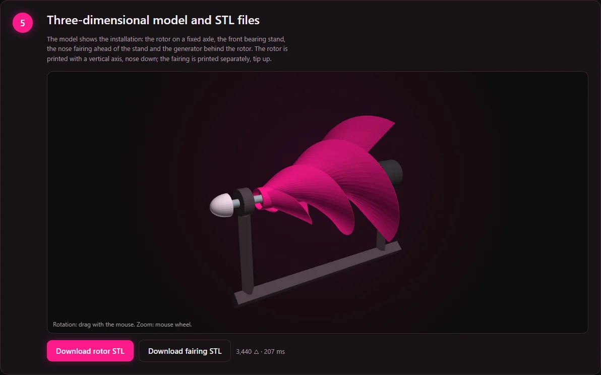
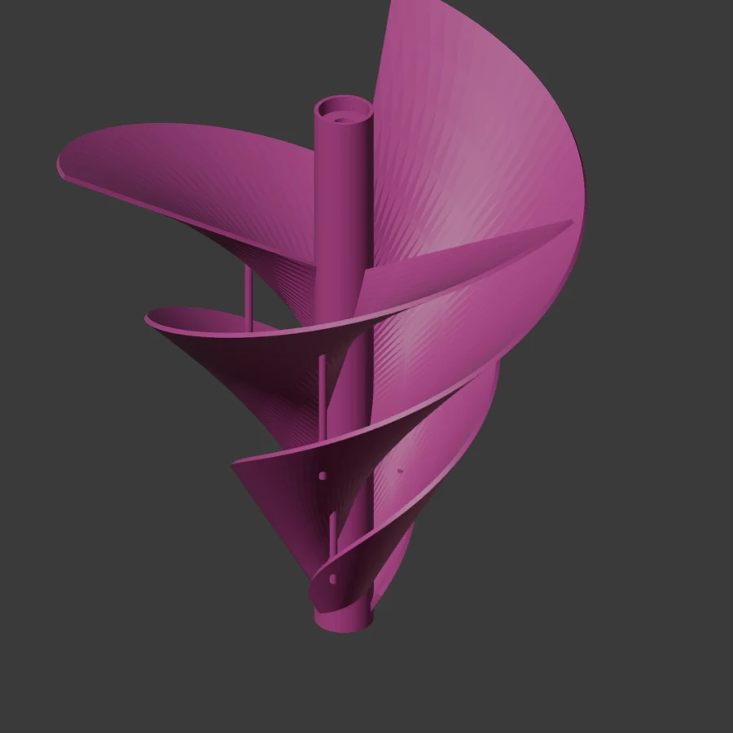
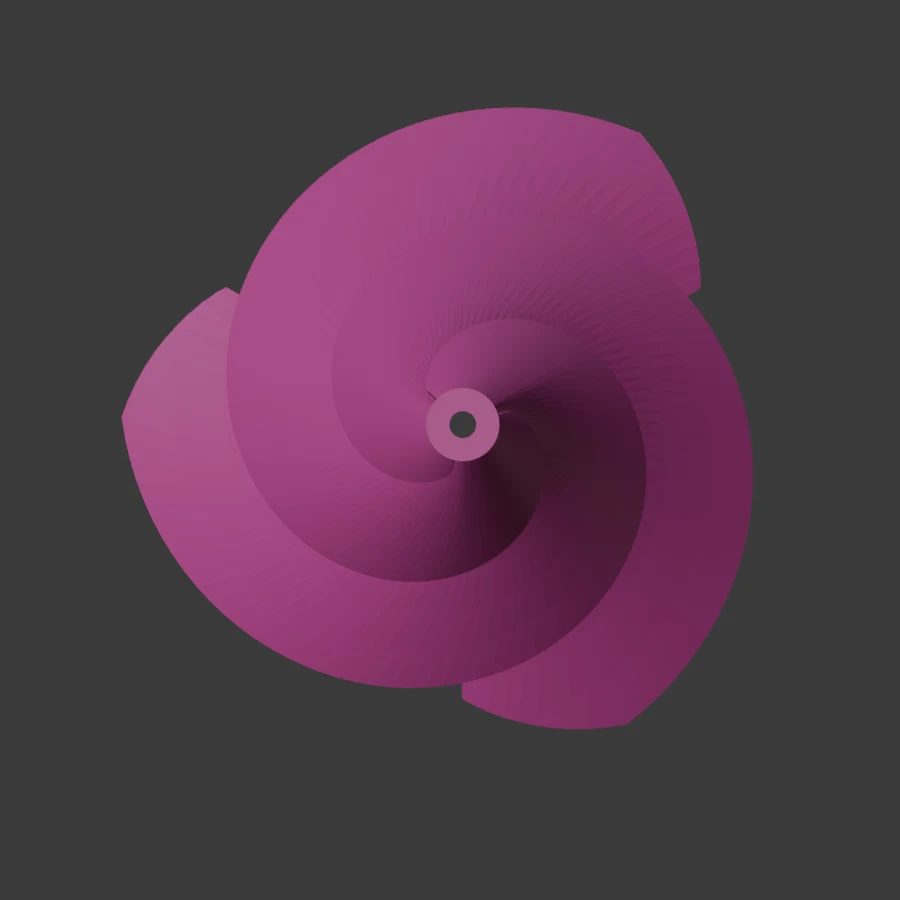
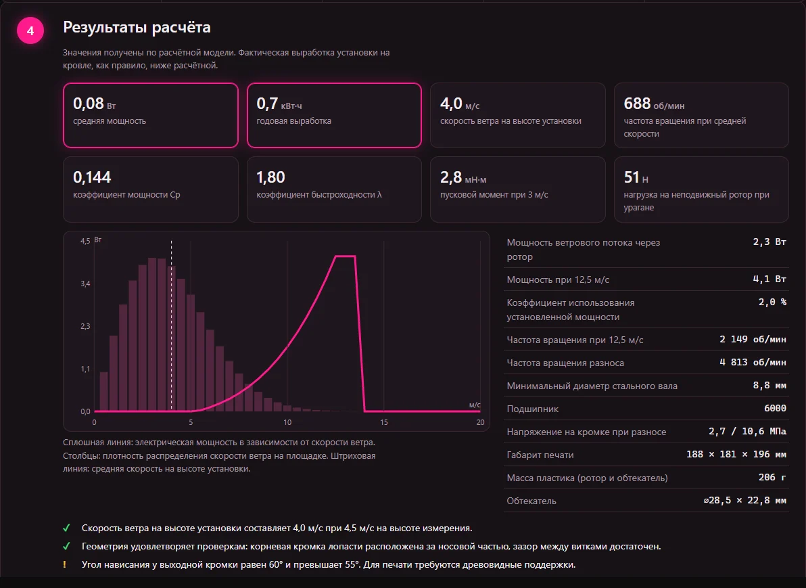
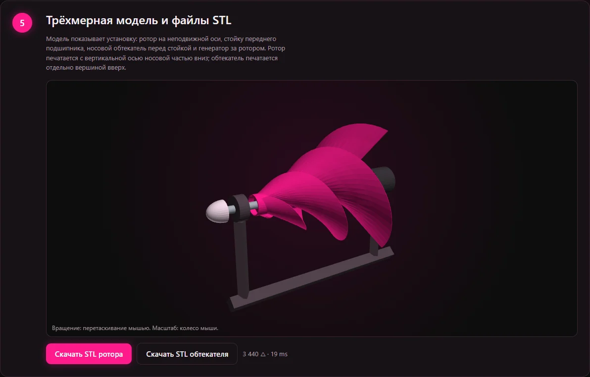

<h2 align="center">KATAK</h2>

  
  &nbsp;
  

<b>Krinik Archimedes Turbine Automated Kalculator</b> 
A browser tool that sizes an Archimedes spiral wind turbine for your site and generates its STL for your 3D printer

  
  
  
  
  

[Читать по-русски →](#russian)

**KATAK** sizes an Archimedes spiral wind turbine — the conical three-blade rotor shaped like a nautilus shell — and
writes the STL files of its rotor and nose, fitted to the nozzle of your 3D printer. Describe the site and the printer, and
the page shows the power and the energy per year the turbine gives, its rpm and torque, the storm load on its shaft, the
steel shaft and the bearing it needs, and the mass of plastic. The tool is one HTML file: open `kalculator/index.html` with
a double click, and it works in the browser with no install, no account and no network. Everything stays on your
computer.

  

  

  

### What it does

1. **Brings the wind to the turbine.** The mean wind of a weather station (usually measured at 10 m) is brought to the
   turbine's height by the terrain type, with the air density of your altitude and temperature and the Weibull
   distribution of wind speeds.
2. **Computes the turbine.** The rotor efficiency curve Cp(λ) comes from peer-reviewed studies of spiral turbines (wind
   tunnel and CFD), corrected for the opening angle, the blade count, the wall thickness and the rotor's size. From it the
   page gives the power curve, the energy per year with the losses of the generator and the electronics, the rpm, the
   torque and the starting torque.
3. **Sizes the parts.** The storm load on a parked rotor (IEC 61400-2) gives the diameter of the steel shaft and the
   bearing; the runaway speed gives the stress at the blade tips, checked against the plastic.
4. **Fits the print to your nozzle.** The blade wall is a whole number of extrusion lines of your nozzle (0.2 to 1.0 mm);
   the layer height defaults to half the nozzle.
5. **Generates the STL.** The rotor (three blades on the ruled spiral surface of the studies, the hub with bearing seats
   or a profiled bore — round, hexagon, D-cut, square — or a printed axle, ties between the turns, an optional exit rim)
   and the nose fairing as a separate part — ellipsoid, ogive or cone — that sits on the axle 10 to 100 mm ahead of the rotor.
   Every file is a closed mesh; the detail is set from 10 to 100 %.
6. **Shows each step.** The wind profile over height for your terrain, the rotor from the side with its dimensions, the
   cross-section of the blade wall in nozzle lines, the power curve over the wind distribution, and a 3D view of the
   installation with a horizontal axis: the rotor on a fixed axle, the front bearing stand, the nose fairing and the generator.
7. **Says what to expect.** A printed rotor of 0.2–0.6 m gives single watts — enough for a sensor, a light or a
   classroom rig. The page warns about overhangs that need supports, a plastic not meant for the sun, a model larger than
   the printer bed and a runaway speed that needs an electric brake.

  
  

### How to use it

1. Download the repository (or just `kalculator/index.html`) and open the page in a browser.
2. **Site:** enter the mean wind and the height it was measured at, the turbine's height, the terrain and where the
   turbine stands — a mast in a field gives about three times the energy of a typical roof.
3. **Turbine:** enter the diameter, or the power you want at a wind speed, and the page picks the diameter. The other
   fields hold the recommendations of the studies.
4. **Printing:** choose the nozzle, the plastic (ASA for outdoors), the printer bed, the axle and the nose.
5. Read the result and download the STL of the rotor and of the nose. Print the rotor with its axis vertical, nose down;
   the nose prints tip up.

### Development

- `kalculator/index.html` — the tool; the physics and geometry core sits between `CORE-BEGIN` and `CORE-END`.
- `node kalculator/test.mjs` — the core in Node: the wall rule, closed meshes at every detail level and hub mode, STL bytes,
  the physics against the control examples of the research.
- `node tools/ui-run.mjs` — the page in Chrome (Playwright), walked the way a user walks it, with screenshots.
- `node tools/export-stl.mjs` and `tools/render-stl.py` — STL files and Blender renders outside the browser.
- `researches/` — the notes the numbers stand on: the physics of the spiral turbine with its sources, 3D printing for a
  given nozzle, the binary STL and the page.

### Licence

MIT — see [LICENSE](LICENSE).

---

<h2 align="center">KATAK</h2>

  
  &nbsp;
  

<b>Krinik Archimedes Turbine Automated Kalculator</b> 
Браузерный инструмент: рассчитывает спиральную ветротурбину Архимеда под ваше место и генерирует её STL под ваш 3D-принтер

[Read in English →](#english)

**KATAK** рассчитывает спиральную ветротурбину Архимеда и выдаёт STL-файлы её ротора и носа, подогнанные под сопло вашего
3D-принтера. Турбина Архимеда — конический ротор из трёх лопастей, закрученных, как раковина наутилуса. Опишите место и принтер, и
страница покажет мощность и выработку турбины за год, её обороты и момент, нагрузку на вал в бурю, нужный стальной вал и
подшипник, массу пластика. Инструмент — один HTML-файл: откройте `kalculator/index.html` двойным щелчком, и он работает в
браузере без установки, учётной записи и интернета. Всё, что вы вводите, остаётся на вашем компьютере.

  

  

  

### Что умеет

1. **Переносит ветер на высоту турбины.** Средний ветер метеостанции (метеостанции меряют его на высоте 10 м) страница пересчитывает
   на высоту турбины по типу местности, с плотностью воздуха вашей высоты над морем и температуры и с распределением
   Вейбулла для скоростей ветра.
2. **Считает турбину.** Кривая КПД ротора Cp(λ) взята из рецензируемых исследований спиральных турбин — продувок в
   аэродинамической трубе и CFD-расчётов — с поправками на угол раскрытия, число лопастей, толщину стенки и размер ротора.
   Из неё страница выводит кривую мощности, выработку за год с потерями генератора и электроники, обороты, момент и
   стартовый момент.
3. **Подбирает детали.** Нагрузка на неподвижный ротор в бурю (IEC 61400-2) даёт диаметр стального вала и подшипник;
   обороты разноса дают напряжение на кромках лопастей, его страница сверяет с прочностью пластика.
4. **Подгоняет печать под сопло.** Стенка лопасти — целое число линий вашего сопла (от 0,2 до 1,0 мм); высота слоя по
   умолчанию — половина сопла.
5. **Генерирует STL.** Ротор: три лопасти на линейчатой спиральной поверхности из исследований; ступица с посадками под
   подшипники, или с профильным отверстием (круг, шестигранник, D-срез, квадрат), или с печатной осью; стяжки между
   витками; обод на выходе — по желанию. Носовой обтекатель — отдельная деталь в форме эллипсоида, оживала или конуса; он
   садится на ось в 10–100 мм перед ротором. Каждый файл — замкнутая сетка; детализация задаётся от 10 до 100 %.
6. **Показывает каждый шаг.** Профиль ветра по высоте для выбранной местности, ротор сбоку с размерами, сечение стенки
   лопасти по линиям сопла, кривая мощности на фоне распределения ветра и 3D-модель установки с горизонтальной осью: ротор
   на неподвижной оси, стойка переднего подшипника, носовой обтекатель и генератор.
7. **Говорит, чего ждать.** Печатный ротор 0,2–0,6 м даёт единицы ватт: хватит датчику, подсветке, учебному стенду.
   Страница предупреждает о нависаниях, которым нужны поддержки, о пластике, который не держит солнце, о модели больше
   стола принтера и об оборотах разноса, при которых нужен электрический тормоз.

  
  

### Как пользоваться

1. Скачайте репозиторий (или один файл `kalculator/index.html`) и откройте страницу в браузере.
2. **Место:** введите средний ветер и высоту, на которой его измерили, высоту турбины, местность и где турбина стоит:
   мачта в поле даёт примерно втрое больше энергии, чем обычная крыша.
3. **Турбина:** введите диаметр — или мощность, которую хотите получить при заданном ветре, и страница подберёт диаметр.
   Остальные поля заполнены рекомендациями исследований.
4. **Печать:** выберите сопло, пластик (для улицы — ASA), размер стола, ось и нос.
5. Прочитайте результат и скачайте STL ротора и носа. Ротор печатайте осью вертикально, носом вниз; нос — вершиной вверх.

### Разработка

- `kalculator/index.html` — сам инструмент; ядро физики и геометрии стоит между метками `CORE-BEGIN` и `CORE-END`.
- `node kalculator/test.mjs` — ядро в Node: правило стенки, замкнутость сеток на всех уровнях детализации и во всех
  вариантах ступицы, байты STL, физика против контрольных примеров исследования.
- `node tools/ui-run.mjs` — страница в Chrome (Playwright): проход по пути пользователя со снимками экрана.
- `node tools/export-stl.mjs` и `tools/render-stl.py` — STL-файлы и рендеры Blender вне браузера.
- `researches/` — конспекты, на которых стоят числа: физика спиральной турбины с источниками, 3D-печать под заданное
  сопло, двоичный STL и устройство страницы.

### Лицензия

MIT — см. [LICENSE](LICENSE).
